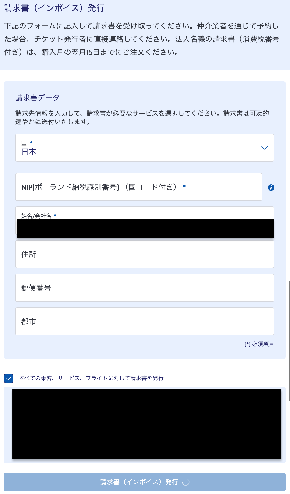
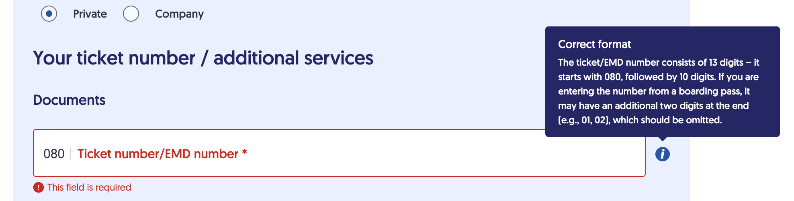

## 結論
ポーランド航空（LOT）の公式ウェブサイトは日本人にあまり優しくなく、請求書を発行できないので、
[Facebook のDM](https://www.facebook.com/LOT/)（別に Facebook じゃなくてもいいが）に以下のような問い合わせを送ろう。

> Hello, I would like to request an invoice for my booking.
> 
> Booking reference: [予約番号]
> 
> I understand that the invoice should normally be available through the website before the flight, but I received an error when I tried to issue it online, so I was unable to complete the process.
> 
> Please issue the invoice to the following individual:
> 
> Full name: [氏名]
> Address: [住所]
>
> I am not requesting the invoice as a company, so I do not have a TAX number.
> 
> Please send the invoice to the email address provided in the reservation.
> 
> Thank you.


ポイントは、相手がすぐに返事をしてくれるとは限らず、そのくせこちらの返事をすぐに返さないとチャットが閉じられてしまう（体験談）ので、
こちらの事情と相手が必要とする情報を最初からすべて送ることだ。
ウェブサイトから請求書を発行できないこと、TAX番号がないこと、氏名と住所、予約番号を送れば、私の場合は大丈夫だった。

## 経緯

ポーランドに行くことになった。
直行便とトランジットがそこまで大きく違わなかったので、直行便のポーランド航空（LOT）を予約した。
以前、ネットの代理店経由で予約して諸々が面倒くさかったことがあるので、ポーランド航空の公式サイトで予約をした。


### 予約管理画面

請求書が必要なのでWebサイトの予約画面をみてみると、予約管理画面から請求書を発行できるようだ。
その画面で入力すべき情報を入力して、発行のボタンを押すと、永遠にボタンの中でロードを表すスピンが回っていて、請求書が発行されない。




ブラウザの検証画面を確認するとリクエストに失敗している。
ご丁寧にエラーの内容が返ってきていて、どうやら VAT ID のバリデーションで弾かれているようだ。
個人なのでそれに値するものはもっていないし、よしんば VAT ID に類するものがあったとしても、
正規表現をみると日本のものは対応していない。

```json
[
  {
    "path": "vatId",
    "message": "must match \"^(?:(?!(AT|BE|BG|CY|CZ|DE|DK|EE|EL|ES|FI|FR|HR|HU|IE|IT|LT|LU|LV|MT|NL|PL|PT|RO|SE|SI|SK|SL|SM))([a-zA-Z0-9_\\-/]+))|^(?:(AT)?U[0-9]{8}|(BE)?[01][0-9]{9}|(BG)?[0-9]{9,10}|(CY)?[A-Z0-9]{9}|(CZ)?[0-9]{8,10}|(DE)?[0-9]{9}|(DK)?[0-9]{8}|(EE)?[0-9]{9}|(EL|GR)?[0-9]{9}|(ES)?[0-9A-Z][0-9]{7}[0-9A-Z]|(FI)?[0-9]{8}|(FR)?[0-9A-Z]{2}[0-9]{9}|(HR)?[0-9]{11}|(HU)?[0-9]{8}|(IE)?([0-9]{7}[A-Z]{1,2}|[0-9][A-Z][0-9]{5}[A-Z])|(IT)?[0-9]{11}|(LT)?([0-9]{9}|[0-9]{12})|(LU)?[0-9]{8}|(LV)?[0-9]{11}|(MT)?[0-9]{8}|(NL)?[0-9]{9}B[0-2]{2}|(PL)?[0-9]{10}|(PT)?[0-9]{9}|(RO)?[0-9]{2,10}|(SE)?[0-9]{12}|(SI)?[0-9]{8}|(SK)?[0-9]{10}|(SL)?[0-9]{8}|(SM)?[0-9]{9})$\""
  },
  {
    "path": "country",
    "message": "must match \"^[a-zA-Z0-9\\,\\.\\'\\-/\\s]{0,255}$\""
  }
]
```

この画面からは VAT ID を入力しないで請求書を発行することはできないようなので、他の方法を検討する。
ちなみに、country のバリデーションでも弾かれている。
日本語にして請求書の情報を選択すると、国名選択で日本語になって、バックエンドに送ると国名はアルファベットであれと言われて弾かれているようだ。


### 問い合わせフォーム

サイトを丁寧にみてみると、一般のフォームがあった。
そこには当然 [invoice の項目](https://www.lot.com/jp/ja/help-center/contact/forms/invoice)があるので、そこから問い合わせをしてみることにする。



こちらは個人を選択すれば VAT ID の入力は不要のようだが、
今度はチケット番号を入れろと言われる。
ところが、予約管理画面を確認してもそのような番号はない。

つまり、問い合わせでも請求書を発行することができなかった。

## 直接問い合わせる

直接問い合わせたいが、電話は Polish and English なので、あまり気が進まない。
メールはやっていないようで、テキストで問い合わせることができるのは Facebook と Whatsapp のようだ。

Facebook で問い合わせることにして DM を開くと、
チャットボットに誘導される。
ここで、Something else -> Chat with Agent と進まないと自由入力のチャットに進めない。
そして要件を送って待つと、メールで請求書を送ってくれた。

返信に2.5時間くらいかかっているので、おそらく人間が対応しているのだと思う。
返信までが長いくせに、こちらの返事をすぐに返さないとチャットが閉じられてしまうので、最初から必要な情報をすべて送るのがよい。
私は一度チャットが閉じられてしまったので、再度問い合わせを送った。
以下のチャットのやり取りは、二回目の問い合わせで成功したときのもの。


---
2026/07/05 23\:19

🤖 Cześć - witamy w PLL LOT!
🇵🇱 Wybierz język kontaktu

🤖 Hello! Welcome to LOT Polish Airlines!
🇬🇧 Please select the language

---
（私）

🇬🇧 English

---
Cool! We'll talk in English 😎 By selecting the next answers you will receive the requested information.
What would you like to ask about? Please select a field with the relevant conversation topic. If you cannot find the answer to your question, please contact our consultant.

---
（私）

➡️ Something else

---
What would you like to ask about? Please choose one of the available options.

---
（私）

Chat with Agent

---
Do you have an active booking?

---
（私）

Yes

---
Please provide your booking reference (6 characters) or ticket number (starting with 080-) and the passenger's last name.

---
（私）

[予約番号], [姓]

---
❗ Currently, response times may be longer than usual. We apologize for any inconvenience and thank you for your understanding.
 
Please provide your booking number and a passenger's name in a text form, along with a detailed description of your case. The more information you share, the better we can assist you!

---
（私）

Hello, I would like to request an invoice for my booking.

Booking reference: [予約番号]

I understand that the invoice should normally be available through the website before the flight, but I received an error when I tried to issue it online, so I was unable to complete the process.

Please issue the invoice to the following individual:

Full name: [氏名]
Address: [住所]

I am not requesting the invoice as a company, so I do not have a TAX number.

Please send the invoice to the email address provided in the reservation.

Thank you.

---
2026/07/06 1\:46

LOT Polish Airlines
Hello, I have already submitted your request. The invoice will be issued and delivered within one business day.
Thank you!!


---
2026/07/06 2\:31

Is there anything else I can help you with?
Due to lack of activity, the chat will be closed shortly. If you wish to continue the conversation, please send a message.

Due to lack of activity in the chat, the conversation will be ended. If you have any further questions, please feel free to contact us again. Thank you for using our services, and have a nice day.

