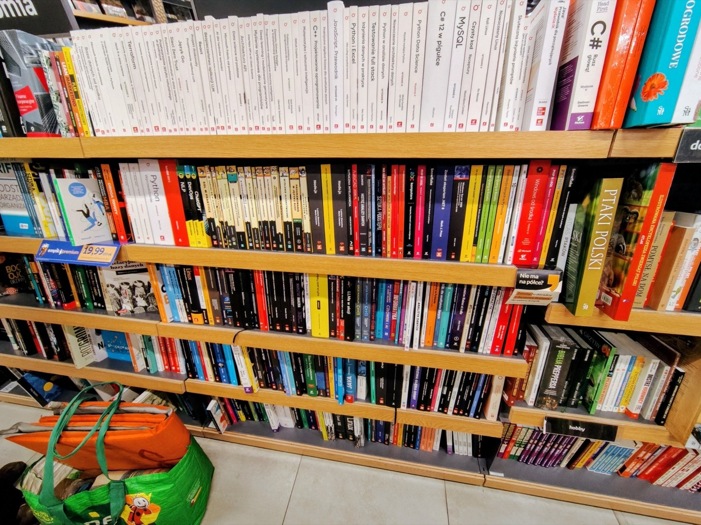

9月からつけ始めている博士課程の記録。せっかくなので遡及入力したいけど、そんな時間はなくて。

## 研究・仕事のこと
第一週、第三週は国際学会の発表スライドの作成と図書館情報学会の予稿の作成をしていた。第四週は国際学会でポーランドに出張していた。

### 国際学会@ポーランド
ポーランドで開催される学会に参加してきた。この学会は4月ごろに採択通知が来ていたので、5ヶ月前から決まっていたことになる。飛行機や宿の手配などはしていたのだけど、スライドや発表原稿の作成は9月に入るまでしていなかった。

修士論文をもとにした内容を出していたので、修論を掘り返しながらスライドを作成した。同じ学会に出る研究室の人とリハーサルをしたり、録画して指導教官に見てもらったりして、十分な準備ができたと思う。

実際、発表自体は質疑応答も含めて及第点だった。ただ、他の人の発表を聞くときや、準備なしの雑談のときに英語力の無さを露呈したので、後期はもう少し英語に割く時間を増やそう。

ついでにワルシャワを観光したり、ポーランド料理を堪能したりした。初ヨーロッパだったので、街並みのファンタジー感や教会の荘厳さを堪能できてよかったし、ピエロギやポンチキ、カツレツも美味しかったのだけど、１週間いると街並みも見慣れてきて、日本食や風呂も恋しくなってきて、やっぱり海外は短期間でいいやとなった。

### 図書館情報学会の予稿
先月投稿して受理された学会の要旨を膨らませて、A4で4p分の予稿を書いた。バージョン1を書き上げた時点で「大きな修正はないんじゃないか」と思っていたのだけど、共著者（指導教官）からコメントをもらって修正すると明らかにわかりやすくなった。
これが自分でできるようになりたいところ。

### 論文を書かなければならない
指導教官と雑談兼ミーティングをしていて、学会発表に出していてとてもよいが、博士課程を3年で出るためには論文ももっと書いていかなければいけない、ということを言われた。
実際、3月から9月までの7ヶ月で主著4本、共著1本という、悪くないペースで出している自負はある。一方で論文はまだ出せていない。
私の所属する研究科では、思っていたよりも論文が重視されるようだ。情報系だと学会の重みが大きいので少し人文系向けに感覚を修正する必要がありそう。

### バイト
8月から始めている図書館系のシステム開発のバイトでは、既存のシステムに新しい機能を実装した。非常にバイト先の役に立つ働きができている。前から続けているバイトは、先月からあまり振るっていない。今月は通常パフォーマンスくらいには戻せたが、わかりやすい成果を出せていないのが少し不安だ。

## 個人のこと

### 作品
ダンダダンという神アニメをおすすめしたい。
漫画の連載当初に途中まで読んでいたのだけど、ターボババアを倒したあたりで畳み方が綺麗すぎて満足して、あとは蛇足だろうなと思って読むのをやめてしまっていた。

その判断は間違っていた。アニメでは、絵、音、声、ストーリーの全てがよかった。OP、EDも一期二期ともに素晴らしい。独特な世界観にみあった色彩設計で、スタイリッシュかつわかりやすい戦闘シーンで、声の演じ分けも違和感なく、登場する妖怪や宇宙人はトイレの花子さんみたいな知名度の高いものではなく尖っているのに人間関係は王道。100点満点の出来だった。

<iframe width="560" height="315" src="https://www.youtube.com/embed/Nw_XzGZ35As?si=JRFEXeFLBRB6pmDw" title="YouTube video player" frameborder="0" allow="accelerometer; autoplay; clipboard-write; encrypted-media; gyroscope; picture-in-picture; web-share" referrerpolicy="strict-origin-when-cross-origin" allowfullscreen></iframe>

<iframe width="560" height="315" src="https://www.youtube.com/embed/ZWjbvYWUMHo?si=QmCtUyOk6d2QaE7Z" title="YouTube video player" frameborder="0" allow="accelerometer; autoplay; clipboard-write; encrypted-media; gyroscope; picture-in-picture; web-share" referrerpolicy="strict-origin-when-cross-origin" allowfullscreen></iframe>

<iframe width="560" height="315" src="https://www.youtube.com/embed/LxUeFYhLE0U?si=QVXP2VXEpvKe4KSR" title="YouTube video player" frameborder="0" allow="accelerometer; autoplay; clipboard-write; encrypted-media; gyroscope; picture-in-picture; web-share" referrerpolicy="strict-origin-when-cross-origin" allowfullscreen></iframe>

あとは安定して面白い無職転生のアニメ。とくにアトーフェラトーフェの回の戦闘シーンと、日記の回の絶望感は、今までの無職転生の良さを継続していた。初回やパウロのときもそうなんだけど、人間の死に顔の描写が本当に生気がなくて怖い。

印象に残っている本は２冊。
１冊目は「[図鑑を見ても名前がわからないのはなぜか？](https://www.beret.co.jp/book/46769)」。生協の書籍部で見かけて、分類学に興味があったので読んだ。非常にわかりやすく書かれていた。自分で手を動かしてやってみるということと、きちんとした手続きに則ってやってみるということをどちらもカバーしており、なおかつちょうど良い文量で、入門書としてこれ以上ないくらいの完成度だった。
２冊目は「[地図と拳](https://www.shueisha.co.jp/books/items/contents.html?isbn=978-4-08-771801-0)」。これはポーランド出張中に読破した。特定の人物に感情移入するというよりは、土地の歴史に想いを馳せる、人間の営みを眺められる本だった。

### 北海道旅行
家族で三泊四日の北海道旅行にいった。飛行機で函館まで行き、一泊。レンタカーを借りて洞爺湖で一泊、小樽を少し散策して札幌で一泊し、四日目の夜に飛行機で帰るという、割とボリューム満点の行程だった。

思いつくままに感想を述べると、ビールがうまい、チーズがうまい、函館の夜景は綺麗だけど羽虫と混雑がすさまじい、あたり。友達に聞くと年中羽虫がいるわけではないらしいので、タイミングが悪かったのだろう。

また、車の運転補助技術が便利すぎる。我が家の車は便利技術が基本的についてないので、全方位カメラや駐車予測といった技術を初めて知って、便利さに感動した。とくに駐車が苦手なのだけど、この技術で安定して駐車できて、非常に嬉しい。

### メガネ
今までメガネを持っていなかったのだけど、Zoff で予備のメガネを買った。海外で壊れたらことだし、日常生活でも予備があるほうがいい。ただ、このメガネが曲者で、横幅が小さく、少し頭が圧迫される感じがある。何回かZoffの店員さんに調整してもらったけど、つけていると夕方ごろには頭が痛くなってくる。

## まとめ
プログラミングバイトで成果を出せていないという一抹の不安はあるが、心身ともに健康。

