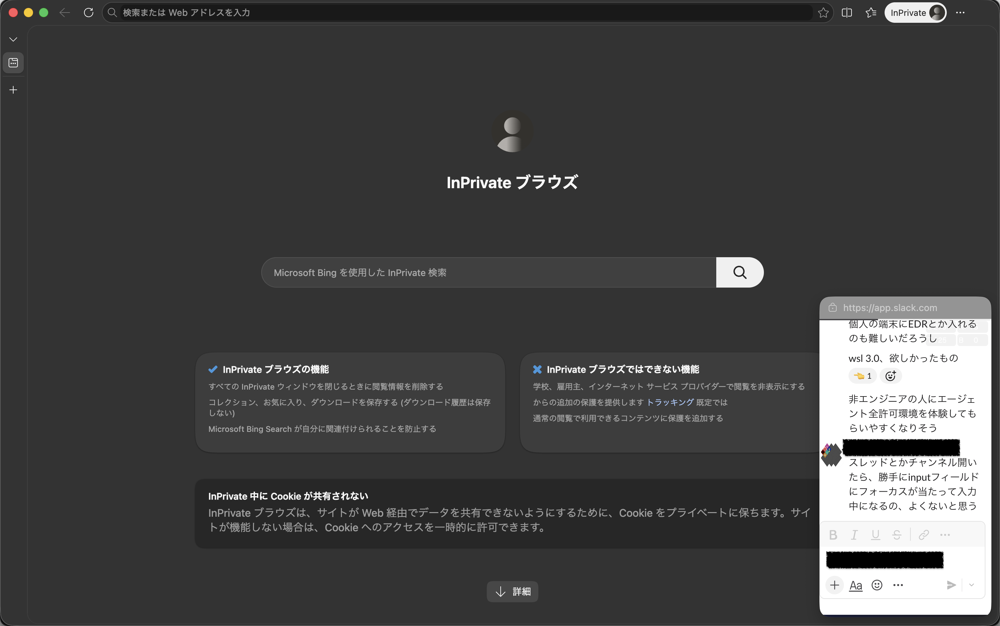
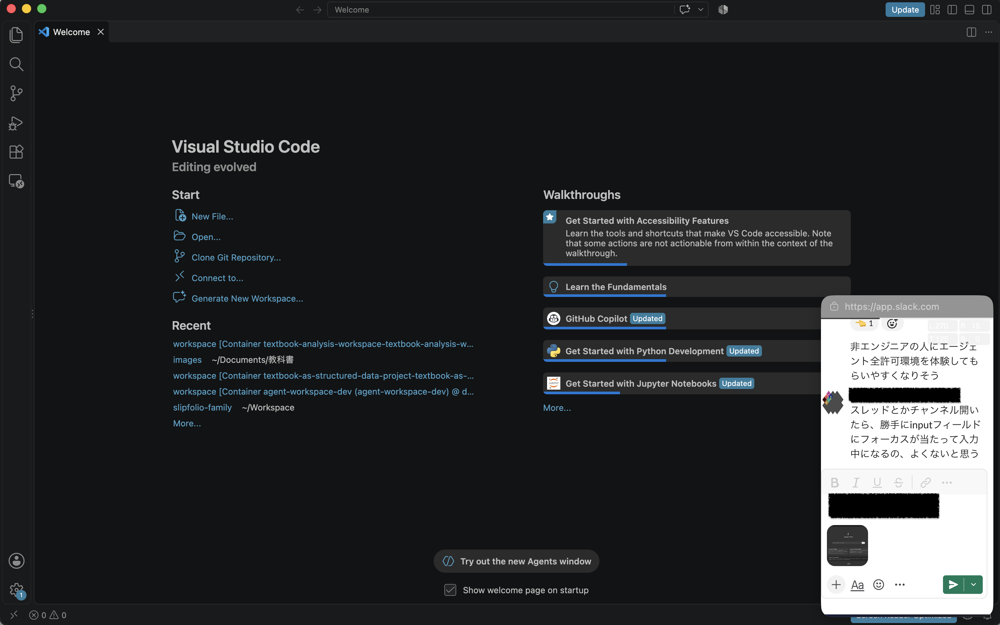

## 利用方法


こんな感じになります。






ブラウザのブックマークに以下のコードを登録して利用してください。
わからない場合は、「ブックマークレット　登録方法」などで検索してください。

```javascript
javascript:(async()=>{try{if(!('documentPictureInPicture'in window)){alert('Document PiP 非対応');return}const w=await documentPictureInPicture.requestWindow({width:420,height:700});w.document.documentElement.style.cssText='margin:0;width:100%;height:100%;overflow:hidden';w.document.body.style.cssText='margin:0;width:100%;height:100%;overflow:hidden;background:white';const f=w.document.createElement('iframe');f.src=location.href;f.style.cssText='display:block;border:0;position:absolute';f.allow='clipboard-read; clipboard-write; fullscreen';const box=w.document.createElement('div');box.style.cssText='position:fixed;top:3px;right:5px;z-index:2147483647;display:grid;grid-template-columns:auto auto;gap:2px;opacity:.28';box.onmouseenter=()=>box.style.opacity='.9';box.onmouseleave=()=>{if(!box.contains(w.document.activeElement))box.style.opacity='.28'};const mk=(label,value)=>{const wrap=w.document.createElement('label');wrap.style.cssText='display:flex;align-items:center;gap:1px;padding:1px 2px;border-radius:4px;background:rgba(0,0,0,.18);color:white;font:10px sans-serif';const s=w.document.createElement('span');s.textContent=label;const n=w.document.createElement('input');n.type='number';n.min='0';n.max='2000';n.step='5';n.value=value;n.style.cssText='width:34px;height:16px;box-sizing:border-box;padding:0 2px;border:0;background:transparent;color:white;font:10px sans-serif;text-align:right;outline:none';wrap.append(s,n);return{wrap,n}};const l=mk('L',120),r=mk('R',120),t=mk('T',0),b=mk('B',0);const u=()=>{const L=Math.max(0,+l.n.value||0),R=Math.max(0,+r.n.value||0),T=Math.max(0,+t.n.value||0),B=Math.max(0,+b.n.value||0);f.style.left=`-${L}px`;f.style.top=`-${T}px`;f.style.width=`calc(100% + ${L+R}px)`;f.style.height=`calc(100% + ${T+B}px)`};[l,r,t,b].forEach(x=>x.n.oninput=u);box.append(l.wrap,r.wrap,t.wrap,b.wrap);w.document.body.append(f,box);u()}catch(e){alert(e.message)}})();
```

実行すると、現在のページが小さなウィンドウで表示され、画面上に常にメモの入力欄を表示させることができます。
上下左右に余計なメニューや余白があるときは、右上の操作ボックスで上下左右個別に余白の調整が可能です。

## モチベ

メモをもっと頻繁にとりたい。
そのためには、メモをすぐに取れる環境が必要で、
とくに画面上に常にメモの入力欄を表示させたり、簡単にメモの入力欄にアクセスできるのが望ましい。
実際、そのようなアプリを個人開発しているけれど、
職場では使ってる端末にインストールできるアプリとか、使えるメモツールとかに制約がある。

とはいえ、どんな職場でもブラウザは使えてブックマークレットを使えば手軽にカスタマイズできるし、
多くのメモツールはブラウザ上で利用可能だ。
また、最近（といっても少し前だけど）Document Picture in Picture API がブラウザに導入されて、
Picture in Picture を好きにカスタマイズできるようになった。

というわけで、このようなツールを作った。
拡張機能とか独自アプリとかいれられない端末でもブラウザでログインさえできれば利用可能なので、結構嬉しいのではないだろうか。
