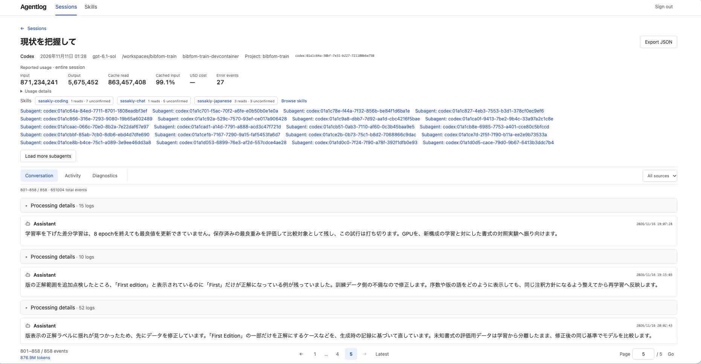

[2026 年 8 月の LLM まわりの利用状況](https://blog.sasakiy84.net/articles/20260824-llm-toolset-202608/)からの変更点をまとめる。
使っているLLMやマシンに大きな変化はないが、ワークフローを変えた。

## ワークフロー

私の使い方の特徴として、複数のリポジトリで並行してLLMを動かし、かつ寿命が短いリポジトリが多いことが挙げられる。
適当に思いついたことを投げて軽く試し、うまくいきそうであればそのリポジトリで作業を続け、うまくいかなければもうそのリポジトリには手をつけない、というスタイルである。

また、数GBから数百GBくらいの中規模データを扱う。これらのデータは大規模データほど管理に手間がかかるわけではないけど、無秩序にしておくと簡単にストレージが底をつくし、
間違えてエージェントにデータを消されたりすると復旧が面倒くさい。

以上から、できるだけ気軽にエージェントの環境を立ち上げて、かつストレージの管理をいい感じにすることを目指してワークフローを構築してみている。

### 手順
devcontainer をベースに、必要に応じて codex remote-control を利用している。
以下のような手順だ。

1. [agent-toolbox/init-devcontainer.sh](https://github.com/sasakiy84/agent-toolbox/blob/main/init-devcontainer.sh)をコピーして実行
2. `devcontainer.json` のプロジェクト名を設定
2. 言語ランタイム、エージェント、スキルやコマンドなどのツール、GPUや Docker in Docker の設定を必要に応じてコメントアウトしたり、マウントやポートの情報を編集
3. devcontainer を VSCode のコマンドパレットからビルド
4. コンテナ内で必要な初期セットアップを行う（エージェントへのログイン、リモートの設定、`gh`コマンドのログインなど）

`codex remote-control start && codex remote-control pair` で繋いだときにわかりやすいように `--hostname` なども .devcontainer 内で設定してある。
リモートで繋いだときは、以下のように表示される。

devcontainer を使っているのは、ファイルの権限周りをいい感じにやってくれるのと、
VSCode で開きやすいのと、いい感じにプレースホルダーが使えるからだ。

### 不満点
おおよそ満足しているけど、不満点はある。

#### 認証情報の共有
まず、codex の認証情報を各コンテナで共有したいけれど、codex remote control 周りの実装の都合でできていない。
認証情報を共有しようとすると codex remote control のサーバー側で使う ID が被ってしまい、どれかひとつのコンテナのみしか認識してくれない。

#### GPU の管理
また、GPU 周りの管理をうまくやりたい。いまは適当に人間がGPUの使用許可を出しているのだけど、[slurm](https://slurm.schedmd.com/)などのジョブスケジューラをサイドカーっぽくたてて使うことも検討している。ただ、個人で使う分には大仰すぎないかという気もしていて迷っている。

#### シークレットの管理
シークレット（エージェントの認証情報ではなく）の管理ももう少し考えたい。
codex cloud のように、通信先とシークレットを紐づける方式のシークレット管理が便利なので導入したくて、
今のワークフローにうまく組み込む方法を探している。
[Docker Sandboxes](https://docs.docker.com/ai/sandboxes/) はやりたいことができそうだけど、あまり使用例や体験を聞かないし、いろいろと大仰そうなので一旦見送っている。
次に試すとしたら[NVIDIA/OpenShell](https://github.com/NVIDIA/OpenShell)かな。

#### プロジェクトの切り替え
しょうがないことだけど、エージェントの環境が分かれているので、どのプロジェクトが何をしているかを把握して、各自に適切に切り替えてもらう必要がある。
単一のエージェントにだけ指示を出して、[サブセッションへのルーティングをエージェントがいい感じにやってくれる](https://rebuild.fm/435/)ようにしてもらっている人の話をきいて、少し羨ましいと思った。

#### 初期設定
いうて、これでも初期設定が面倒。
ChatGPT のログインをしなければいけないし、リモート接続のときはスマホとPCの両方で認証を行う必要がある。

## ログ
ISUCON の話をきいて、もう少しログを見ようと思って、ログを集約する方法を考えている。
[以前からログを集約してはいた](https://blog.sasakiy84.net/articles/20260820-agent-log-collector-via-webdav/)のだけど、それをきちんと閲覧するビューワーがなかったので作った。
また、ログを手動でアップロードするのも面倒なので、ローカルファイルからのセッションログ読み取りと OTEL での受信に対応した。

パフォーマンスが微妙な部分だったり、Skill の集計がうまくいってなかったりするので、改善していく予定。