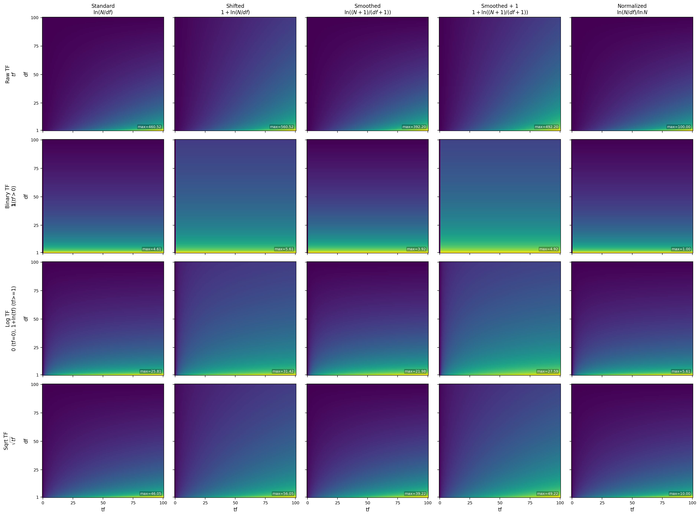
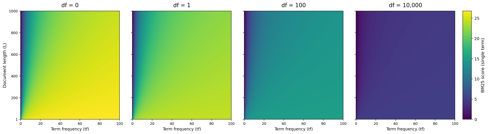

## スコアヒートマップ

### TF-IDF

文書数Nは100。



### BM25



## TF-IDF のコード
```python
import numpy as np
import matplotlib.pyplot as plt
from matplotlib.colors import Normalize
from pathlib import Path

N = 100_000
k1, b = 1.2, 0.75
avg_length = 100
dfs = [0, 1, 100, 10_000]
tf = np.linspace(0, 100, 501)
doc_length = np.arange(1, 1001)
X, Y = np.meshgrid(tf, doc_length)

def bm25_scores(df):
    idf = np.log1p((N - df + 0.5)/(df + 0.5))
    denom = X + k1 * (1 - b + b * Y/avg_length)
    return idf * X*(k1+1)/denom

scores = [bm25_scores(df) for df in dfs]
vmax = max(np.max(s) for s in scores)
fig, axes = plt.subplots(1, 4, figsize=(18, 5.2), dpi=160, sharex=True, sharey=True)
for ax, df, score in zip(axes, dfs, scores):
    img = ax.imshow(
        score, origin="lower", aspect="auto",
        extent=(0, 100, 1, 1000),
        cmap="viridis", vmin=0, vmax=vmax,
        interpolation="nearest",
    )
    ax.set_title(f"df = {df:,}", fontsize=14, pad=10)
    ax.set_xticks(np.arange(0, 101, 20))
    ax.set_xlabel("Term frequency (tf)", fontsize=10)
    ax.set_yticks([1, 200, 400, 600, 800, 1000])
    ax.tick_params(labelsize=9)
axes[0].set_ylabel("Document length (L)", fontsize=11)
fig.subplots_adjust(left=0.06, right=0.90, bottom=0.15, top=0.88, wspace=0.13)
cax = fig.add_axes([0.915, 0.15, 0.017, 0.73])
cb = fig.colorbar(img, cax=cax)
cb.set_label("BM25 score (single term)", fontsize=11)

output = Path("/mnt/data/bm25_heatmaps_doclength_tf_by_df.png")
fig.savefig(output, dpi=200, bbox_inches="tight")
plt.show()
print(output)
```

## BM25 のコード
```python
import numpy as np
import matplotlib.pyplot as plt
from matplotlib.colors import Normalize

# Shared conditions
N = 100
tf = np.arange(0, 101, dtype=float)
df = np.arange(1, 101, dtype=float)

# TF variations (rows)
log_tf = np.zeros_like(tf)
log_tf[tf > 0] = 1 + np.log(tf[tf > 0])

tf_variants = [
    ("Raw TF", r"$tf$", tf),
    ("Binary TF", r"$\mathbf{1}(tf>0)$", (tf > 0).astype(float)),
    ("Log TF", "0 (tf=0), 1+ln(tf) (tf>=1)", log_tf),
    ("Sqrt TF", r"$\sqrt{tf}$", np.sqrt(tf)),
]

# IDF variations (columns); Probabilistic IDF excluded
idf_variants = [
    ("Standard", r"$\ln(N/df)$", np.log(N / df)),
    ("Shifted", r"$1+\ln(N/df)$", 1 + np.log(N / df)),
    ("Smoothed", r"$\ln((N+1)/(df+1))$",
     np.log((N + 1) / (df + 1))),
    ("Smoothed + 1", r"$1+\ln((N+1)/(df+1))$",
     1 + np.log((N + 1) / (df + 1))),
    ("Normalized", r"$\ln(N/df)/\ln N$",
     np.log(N / df) / np.log(N)),
]

fig, axes = plt.subplots(
    4, 5, figsize=(19, 14), sharex=True, sharey=True
)

for i, (tf_name, tf_formula, tf_weight) in enumerate(tf_variants):
    for j, (idf_name, idf_formula, idf_weight) in enumerate(idf_variants):
        ax = axes[i, j]
        score = np.outer(idf_weight, tf_weight)
        vmax = float(score.max())

        ax.imshow(
            score,
            origin="lower",
            aspect="auto",
            extent=(-0.5, 100.5, 0.5, 100.5),
            interpolation="nearest",
            cmap="viridis",
            norm=Normalize(vmin=0, vmax=vmax),
        )

        if i == 0:
            ax.set_title(f"{idf_name}\n{idf_formula}", fontsize=10, pad=6)
        if j == 0:
            ax.set_ylabel(f"{tf_name}\n{tf_formula}\n\ndf", fontsize=10)
        if i == len(tf_variants) - 1:
            ax.set_xlabel("tf", fontsize=10)

        ax.text(
            0.98, 0.02, f"max={vmax:.2f}",
            transform=ax.transAxes,
            ha="right", va="bottom",
            fontsize=7, color="white",
            bbox=dict(
                boxstyle="round,pad=0.16",
                facecolor=(0, 0, 0, 0.28),
                edgecolor="none",
            ),
        )

        ax.set_xticks([0, 25, 50, 75, 100])
        ax.set_yticks([1, 25, 50, 75, 100])
        ax.tick_params(labelsize=8)

# No overall title or explanation above the grid
fig.tight_layout()
fig.savefig("tfidf_grid_4x5_clean.png", dpi=200, bbox_inches="tight")
plt.show()
```
